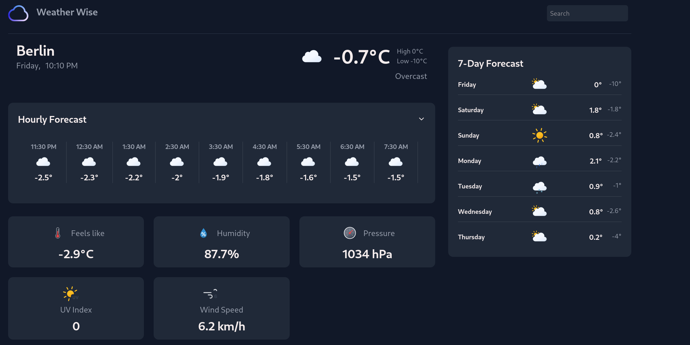

# Weather App



A weather application that displays current, daily, and hourly weather information.

## Setup

1. Clone the repository
2. Install dependencies:

   ```bash
   npm install
   ```

3. Create a `.env` file in the root directory (copy from `.env.example`):

   ```bash
   cp .env.example .env
   ```

4. Get your API key from [Visual Crossing Weather](https://www.visualcrossing.com/) and add it to your `.env` file:

   ```
   WEATHER_API_KEY=api_key
   ```

5. **Run both Backend and Frontend together** (Recommended):
   ```bash
   npm run dev:all
   ```

   *Or run them separately in two terminals:*
   - **Frontend**: `npm run dev` (runs on `https://localhost:8080`)
   - **Backend**: `npm run server:dev` or `npm run server` (runs on `http://localhost:3000`)

## Backend API & Features

The Node.js backend (`server.js`) runs on `http://localhost:3000` with:

- **Weather Proxy & Key Protection (Feature 1)**:
  - `GET /api/weather?city=London`: Safely fetches weather data from Visual Crossing on the server without exposing the `WEATHER_API_KEY` to client-side code.

- **Favorites CRUD (Feature 2 - MongoDB Atlas & Mongoose)**:
  - `GET /api/favorites`: Returns all saved favorite cities from MongoDB Atlas.
  - `POST /api/favorites`: Validates input and saves a new city (`{ "city": "London" }`), preventing duplicate entries (`409 Conflict`).
  - `DELETE /api/favorites/:city`: Removes a city from MongoDB by city name or ObjectId (`404 Not Found` if not found).

- **Custom Middlewares (Feature 3)**:
  - **Request Logger**: Tracks incoming method, route, response status, and duration in ms.
  - **Validation Middleware**: Validates and sanitizes city input (length, forbidden characters, trim).
  - **Central Error Handling Middleware**: Catch-all for uncaught and Mongoose errors (duplicate key, CastError, ValidationError) returning structured `{ error, message }` JSON payloads.
  - **CORS & JSON Parser**: Allows cross-origin API requests from development frontends.

## Environment Variables

- `WEATHER_API_KEY` - Your Visual Crossing Weather API key (required)
- `MONGODB_URI` - Your MongoDB Atlas connection string (required)
- `PORT` - (Optional) Node server port, defaults to `3000`
